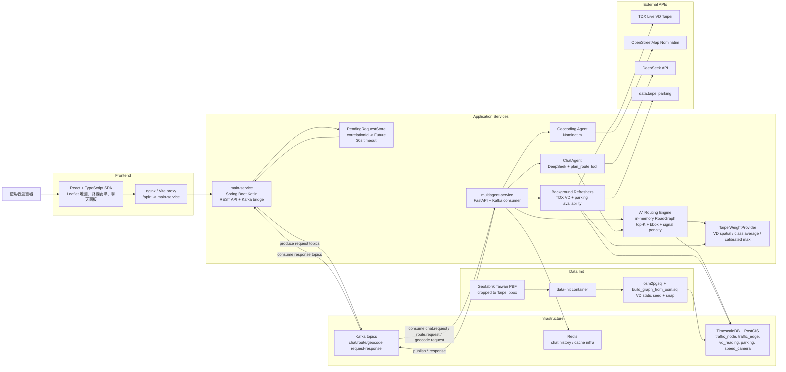
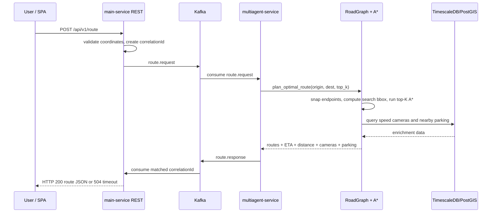
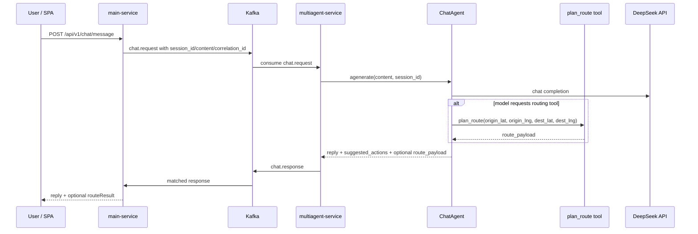
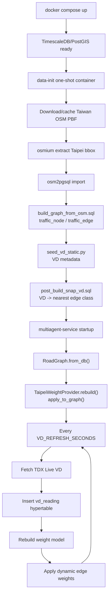

# Smart Traffic System 專題海報／簡報／講稿素材包

本文以目前 codebase 與 OpenSpec 為主要事實來源，`references/` 內舊文件只作輔助比對。若舊文件與程式碼衝突，以程式碼、`infra/docker-compose.yml`、`openspec/specs/` 與 active changes 為準。

## 一句話定位

Smart Traffic System 是一套台北區域智慧路線規劃 demo stack：前端提供地圖、地址查詢、路線結果與聊天入口；主服務用 REST API 對外並透過 Kafka 橋接非同步任務；multiagent-service 以 Python FastAPI 啟動 AI agent、A* 路徑規劃、即時 VD 車速權重、停車推薦與地理編碼。

## 目前實作狀態

| 類別 | 狀態 | 依據 |
| --- | --- | --- |
| 前端 demo app | 已實作 | `frontend/src/App.tsx`, `frontend/src/components/*`, `frontend/src/api/*.ts` |
| REST API gateway | 已實作 | `backend/main-service/src/main/kotlin/com/potato/mainservice/controller/*.kt` |
| Kafka request-response bridge | 已實作 | `backend/main-service/.../kafka/*.kt`, `backend/multiagent-service/src/kafka/consumer.py` |
| A* 路線規劃 | 已實作 | `backend/multiagent-service/src/agents/routing.py` |
| VD 即時車速權重 | 已實作 | `backend/multiagent-service/src/agents/vd_traffic.py`, `weight_provider.py` |
| 終點附近停車推薦 | 已實作 | `backend/multiagent-service/src/agents/parking.py`, `routing.py` |
| Redis 聊天歷史 | 已實作 | `backend/multiagent-service/src/agents/chat_history.py` |
| OSM 路網初始化 | 已實作 | `infra/data-init/entrypoint.sh`, `scripts/build_graph_from_osm.sql` |
| `tune-eta-signal-density` | OpenSpec active，尚未完全落地 | spec 要求 signal penalty 預設 40 秒與 `intersection_count` multiplier；目前 code 預設仍是 20 秒，DB/model 未見 `intersection_count` |

## Tech Stack

| 層級 | 技術 | 用途 |
| --- | --- | --- |
| Frontend | React 19, TypeScript, Vite, Tailwind CSS, Leaflet, Zustand | 單頁 demo app、地圖呈現、路線表單、聊天面板、全域狀態 |
| API gateway | Kotlin, Spring Boot 4, Spring Web, Spring Kafka, Spring Data Redis/JPA | 對外 REST API、Kafka correlation ID 橋接、30 秒同步等待 |
| Agent service | Python 3.12, FastAPI, uv, SQLAlchemy async, asyncpg, confluent-kafka | Kafka consumer、A* routing、AI chat agent、資料刷新背景任務 |
| AI / Tooling | DeepSeek OpenAI-compatible API, OpenAI Python SDK style client, MCP FastMCP tool wrapper | 自然語言聊天、可選 tool-calling 路線規劃 |
| Data | TimescaleDB/PostgreSQL, PostGIS, Redis | 路網、VD 時序、停車時序、空間查詢、聊天歷史快取 |
| Messaging | Kafka, ZooKeeper, Kafka UI | main-service 與 multiagent-service 的 request-response topic |
| Bootstrap | Docker Compose, data-init, osmium, osm2pgsql, SQL scripts | 下載 OSM PBF、裁切台北 bbox、建圖、seed VD static、snap VD 到路網 |
| External data | TDX Live VD, OpenStreetMap Nominatim, Geofabrik OSM, data.taipei | 即時車速、地址轉座標、路網原始資料、停車資料 |

## 系統架構圖

## 路線規劃流程圖

## 聊天與自然語言路線流程圖

## 資料初始化與即時權重流程圖

## 核心資料模型

| Table / Store | 角色 | 重點欄位 |
| --- | --- | --- |
| `traffic_node` | A* graph node | `id`, `latitude`, `longitude`, `geom`, `has_signal` |
| `traffic_edge` | 可行駛路段 edge | `source_node_id`, `target_node_id`, `road_name`, `length_km`, `road_class`, `max_speed_kmh`, `oneway`, `geom` |
| `vd_static` | VD 偵測器靜態資料 | `vdid`, `latitude`, `longitude`, `road_class`, `snapped_road_class` |
| `vd_reading` | VD lane-level 時序資料 | hypertable, `ts`, `vdid`, `lane_no`, `avg_speed`, `volume`, `occupancy` |
| `speed_camera` | 測速照相機 | `latitude`, `longitude`, `direction`, `speed_limit`, `nearest_edge_id` |
| `parking_lot` | 停車場靜態資料 | `id`, `name`, `address`, `latitude`, `longitude`, `geom` |
| `parking_availability` | 停車場即時剩餘車位 | hypertable, `ts`, `lot_id`, `available_car` |
| Redis `chat:history:{session_id}` | 聊天上下文 | 最近 N 輪 user/assistant turn，TTL 預設 1800 秒 |

## Kafka Topic 合約

| Topic | Producer | Consumer | 內容 |
| --- | --- | --- | --- |
| `route.request` | main-service | multiagent-service | 起終點座標、`top_k`、`correlation_id` |
| `route.response` | multiagent-service | main-service | `routes`, `error`, ETA、距離、測速、停車推薦 |
| `chat.request` | main-service | multiagent-service | `session_id`, `content`, `correlation_id` |
| `chat.response` | multiagent-service | main-service | `reply`, `suggested_actions`, optional `route_payload` |
| `geocode.request` | main-service | multiagent-service | `query`, `city_hint`, `limit`, `correlation_id` |
| `geocode.response` | multiagent-service | main-service | geocoding candidates 或 error |
| `traffic.alerts` | optional producer | main-service | 目前只有 consumer log，未接入核心路線計算 |

## A* 與 ETA 設計重點

1. Graph 在 multiagent-service startup 時從 PostGIS 一次載入記憶體，減少每次查詢的 DB traversal。
2. `TrafficEdge` 的 weight 代表小時，公式大致為 `length_km / speed_kmh`；speed 由 `TaipeiWeightProvider` 決定。
3. 權重來源採三層 fallback：
   - Tier 1：edge midpoint 附近 VD 的 inverse-distance weighted speed。
   - Tier 2：同 road_class 的 VD 平均速度。
   - Tier 3：OSM/default maxspeed 乘上校正比例，最後保底。
4. 查詢時先將起終點 snap 到路網，再用 bounding box 限制 A* frontier；找不到路會用較寬 bbox retry 一次。
5. top-K route 用 penalty-based rerun，讓替代路線不只是同一路徑的小變形。
6. 中間節點若有 `has_signal`，A* 加上 signal stop penalty；目前程式預設 20 秒，可用 `SIGNAL_PENALTY_SECONDS` 覆寫。

## 可用於海報的問題與貢獻描述

### 問題

一般導航系統能給路線，但專題 demo 需要展示「資料如何進入系統、如何影響演算法、如何被前端與 AI 互動使用」。本系統把台北路網、VD 即時車速、停車資訊、地理編碼與聊天式查詢整合成一個可運行的端到端架構。

### 方法

1. 以 OSM + PostGIS 建立可搜尋道路圖。
2. 以 TDX VD 即時車速定期更新路段權重。
3. 以 A* + top-K penalty 搜尋多條候選路線。
4. 以 Kafka correlation ID pattern 把 Spring REST API 與 Python agent service 解耦。
5. 以 DeepSeek chat agent 與 `plan_route` tool 支援自然語言路線查詢。
6. 以停車與測速資料豐富路線結果，讓 demo 不只輸出 polyline。

### 成果

系統可由 Docker Compose 啟動完整 demo stack，前端支援地圖視覺化、地址 autocomplete、路線摘要、測速點、停車推薦與聊天面板。後端架構將 HTTP、Kafka、AI agent、路網演算法與時序資料分層，方便展示、測試與後續擴充。

## 海報版面建議

| 區塊 | 內容 |
| --- | --- |
| 標題 | Smart Traffic System：結合即時交通資料與 AI Agent 的台北智慧路線規劃 |
| 背景問題 | 靜態最短路徑無法反映即時車速、停等、停車需求與自然語言互動 |
| 系統架構 | 放「系統架構圖」，強調 REST gateway、Kafka、multiagent、TimescaleDB/PostGIS |
| 核心流程 | 放「路線規劃流程圖」或精簡為 5 步：輸入、橋接、規劃、加值、回傳 |
| 技術亮點 | OSM 建圖、A* top-K、VD dynamic weight、PostGIS enrichment、DeepSeek tool-calling |
| Demo 畫面 | 地圖、候選路線、路線摘要、聊天結果、停車推薦 |
| 實作驗證 | 單元測試涵蓋 frontend hooks/API behavior、main-service controllers/Kafka、multiagent routing/consumer/DB models |
| 未來工作 | ETA 校準、個人化權重、incident/news integration、routing engine performance migration |

## 簡報大綱

1. 專題動機：為什麼路線規劃需要即時資料與可互動介面。
2. 使用情境：輸入起終點或直接用聊天詢問路線。
3. 系統總覽：React frontend、Spring main-service、Kafka、Python multiagent、TimescaleDB/PostGIS。
4. 資料管線：OSM 建圖、TDX VD、停車資料、Nominatim。
5. 路線演算法：snap to graph、A*、bbox pruning、top-K、dynamic weight。
6. AI Agent：DeepSeek 判斷意圖，必要時呼叫 `plan_route` tool。
7. Demo：地圖路線、測速照相、停車推薦、聊天路線結果。
8. 工程設計：Kafka correlation ID 解耦、Redis history、Docker Compose 一鍵啟動。
9. 已知限制與未來工作：ETA 校準、active OpenSpec `tune-eta-signal-density`、更高效 routing engine。

## 3-5 分鐘講稿草稿

各位好，我們的專題是 Smart Traffic System，目標是做出一個能展示即時交通資料、路線演算法與 AI 互動的台北智慧路線規劃系統。

系統前端是 React 與 Leaflet 地圖，使用者可以輸入起點終點，也可以用聊天方式詢問路線。前端所有 API 都先打到 Kotlin Spring Boot 的 main-service。main-service 不直接做 AI 或路徑搜尋，而是把請求轉成 Kafka message，附上 correlation ID，送給 Python multiagent-service 處理，再等待對應 response 回來。這樣 HTTP 介面保持同步好用，內部服務又能用非同步 topic 解耦。

multiagent-service 是整個智慧邏輯的核心。啟動時，它會從 TimescaleDB/PostGIS 載入 OSM 建好的道路圖，形成 in-memory RoadGraph。路線規劃使用 A*，先把起終點 snap 到路網，再用 bounding box 限制搜尋範圍，並用 penalty-based top-K 找出多條替代路線。每條 edge 的 travel time weight 不是固定值，而是由 TaipeiWeightProvider 依照 TDX VD 即時車速估計；如果附近有 VD，就用空間加權平均，沒有就退回同道路類型平均，再不行就用預設速限校正。

除了路線本身，我們也把路線結果做加值。系統會查詢沿途測速照相機，並用 PostGIS 找終點一公里內、剩餘車位足夠的停車場，讓輸出更接近實際導航需要的資訊。

AI 的部分，ChatAgent 使用 DeepSeek 的 OpenAI-compatible API。當使用者在聊天中表達路線需求時，agent 可以呼叫 `plan_route` tool，最後回傳自然語言回覆與結構化 route payload。前端收到後可以直接把路線畫在地圖上。

資料初始化則由 Docker Compose 裡的 data-init container 負責。它下載 Geofabrik Taiwan OSM PBF，裁切台北 bbox，透過 osm2pgsql 匯入 PostGIS，再執行 SQL 建立 `traffic_node` 與 `traffic_edge`。後續 multiagent-service 會定期拉 TDX VD 與停車資料，寫入 TimescaleDB，並更新記憶體中的 edge weight。

目前系統已完成端到端 demo stack，重點貢獻是把前端互動、REST/Kafka 架構、AI agent、A* 路線規劃、PostGIS 空間資料與即時交通權重整合在同一個可啟動、可展示、可測試的專題系統中。

## 舊文件衝突與使用注意

1. `references/future_planning.md` 主要是未來 Rust / 高效 routing migration 構想，不是目前已實作架構。
2. 部分舊 OpenSpec 或 reference 文字仍提到 Gemini、gRPC、Kaohsiung、data.taipei VD XML 或舊 TDX section mapping；目前 code 以 DeepSeek、Kafka、Taipei、TDX Live VD JSON 為準。
3. `openspec/changes/tune-eta-signal-density` 是 active change，描述 signal penalty 40 秒與 intersection-density multiplier；目前 code 尚未完全反映，海報若要寫成成果，需先完成該 change。
4. 程式碼中有一些中文 UI / log 字串呈現 mojibake，文件與海報建議自行重寫展示文案，不直接截取那些字串。

## 可核對的主要檔案

| 主題 | 檔案 |
| --- | --- |
| Docker compose 全系統 | `infra/docker-compose.yml` |
| 資料初始化 | `infra/data-init/entrypoint.sh`, `scripts/build_graph_from_osm.sql`, `scripts/seed_vd_static.py`, `scripts/post_build_snap_vd.sql` |
| 前端 UI | `frontend/src/App.tsx`, `frontend/src/components/MapView.tsx`, `RouteForm.tsx`, `RouteSummary.tsx`, `ChatPanel.tsx` |
| 前端 API | `frontend/src/api/route.ts`, `chat.ts`, `geocode.ts`, `client.ts` |
| REST controllers | `backend/main-service/src/main/kotlin/com/potato/mainservice/controller/RouteController.kt`, `ChatController.kt`, `GeocodeController.kt` |
| Kafka bridge | `backend/main-service/src/main/kotlin/com/potato/mainservice/kafka/*.kt`, `backend/multiagent-service/src/kafka/consumer.py` |
| A* routing | `backend/multiagent-service/src/agents/routing.py` |
| Dynamic weight | `backend/multiagent-service/src/agents/weight_provider.py`, `vd_traffic.py` |
| Agent / tool | `backend/multiagent-service/src/agents/chat_agent.py`, `backend/multiagent-service/src/mcp_servers/routing_tool.py` |
| Geocoding | `backend/multiagent-service/src/agents/geocoding.py` |
| Parking | `backend/multiagent-service/src/agents/parking.py` |
| Chat history | `backend/multiagent-service/src/agents/chat_history.py` |
| OpenSpec main specs | `openspec/specs/*/spec.md` |
| Active changes | `openspec/changes/taipei-opendata-rebuild`, `openspec/changes/tune-eta-signal-density` |
