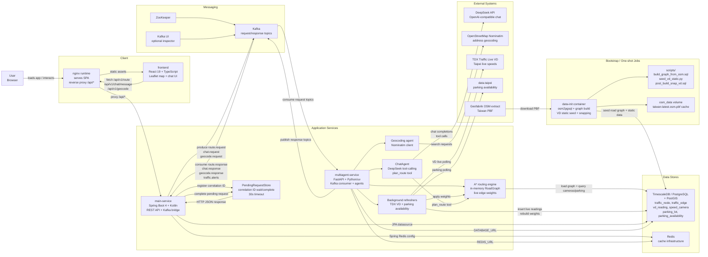

# Smart Traffic System Architecture

This document summarizes the current system architecture from the codebase.
The diagram uses a C4 Container style: user-facing clients, application
containers, infrastructure services, persistent stores, and external systems.

## Container Diagram

## Main Runtime Flows

### Route Planning

1. The React SPA calls `POST /api/v1/route` through nginx or the Vite dev proxy.
2. `main-service` validates coordinates, creates a UUID correlation ID, stores a
   pending future, and publishes `route.request`.
3. `multiagent-service` consumes `route.request`, runs A* over the in-memory
   `RoadGraph`, enriches the best routes with speed cameras and parking
   suggestions, and publishes `route.response`.
4. `main-service` consumes `route.response`, completes the matching pending
   request, and returns HTTP JSON to the SPA. If no response arrives within
   30 seconds, it returns HTTP 504.

### Chat With Optional Route Result

1. The SPA calls `POST /api/v1/chat/message`.
2. `main-service` bridges the request to `chat.request` with the same
   correlation ID pattern.
3. `multiagent-service` forwards the message to `ChatAgent`.
4. `ChatAgent` calls DeepSeek when `DEEPSEEK_API_KEY` is available. If the model
   chooses the `plan_route` tool, the agent invokes the same routing engine.
5. `chat.response` includes a natural-language `reply`, `suggested_actions`,
   and optional `route_payload`. `main-service` maps `route_payload` to
   `routeResult` for the frontend.

### Geocoding

1. The SPA calls `GET /api/v1/geocode?q=...&cityHint=...&limit=...`.
2. `main-service` publishes `geocode.request`.
3. `multiagent-service` calls OpenStreetMap Nominatim with a custom User-Agent
   and rate limiting.
4. Results are returned through `geocode.response` and then to the SPA as HTTP
   JSON.

### Live Data And Bootstrap

1. `data-init` seeds the database by downloading/caching the Geofabrik Taiwan
   OSM PBF, running `osm2pgsql`, building `traffic_node` / `traffic_edge`, and
   seeding VD static metadata.
2. On startup, `multiagent-service` loads the road graph from PostGIS into
   memory and builds initial dynamic edge weights.
3. Background refreshers periodically poll TDX VD live traffic and data.taipei
   parking availability, insert readings into TimescaleDB/PostGIS, rebuild
   weight models, and apply new edge weights to the in-memory graph.

## Codebase Mapping

| Area | Files |
| --- | --- |
| Full stack compose | `infra/docker-compose.yml` |
| Frontend app and API clients | `frontend/src/App.tsx`, `frontend/src/api/*.ts`, `frontend/nginx.conf`, `frontend/vite.config.ts` |
| REST to Kafka bridge | `backend/main-service/src/main/kotlin/com/potato/mainservice/controller/*.kt`, `backend/main-service/src/main/kotlin/com/potato/mainservice/kafka/*.kt` |
| Multiagent startup/runtime | `backend/multiagent-service/main.py`, `backend/multiagent-service/src/kafka/runtime.py` |
| Kafka topic handlers | `backend/multiagent-service/src/kafka/consumer.py`, `backend/multiagent-service/src/kafka/producer.py` |
| Routing and tool interface | `backend/multiagent-service/src/agents/routing.py`, `backend/multiagent-service/src/mcp_servers/routing_tool.py` |
| Chat, geocoding, live data | `backend/multiagent-service/src/agents/chat_agent.py`, `backend/multiagent-service/src/agents/geocoding.py`, `backend/multiagent-service/src/agents/vd_traffic.py`, `backend/multiagent-service/src/agents/parking.py` |
| Database models | `backend/multiagent-service/src/db/models.py`, `infra/init-db/*.sql` |
| Data bootstrap | `infra/data-init/entrypoint.sh`, `scripts/build_graph_from_osm.sql`, `scripts/seed_vd_static.py`, `scripts/post_build_snap_vd.sql` |
